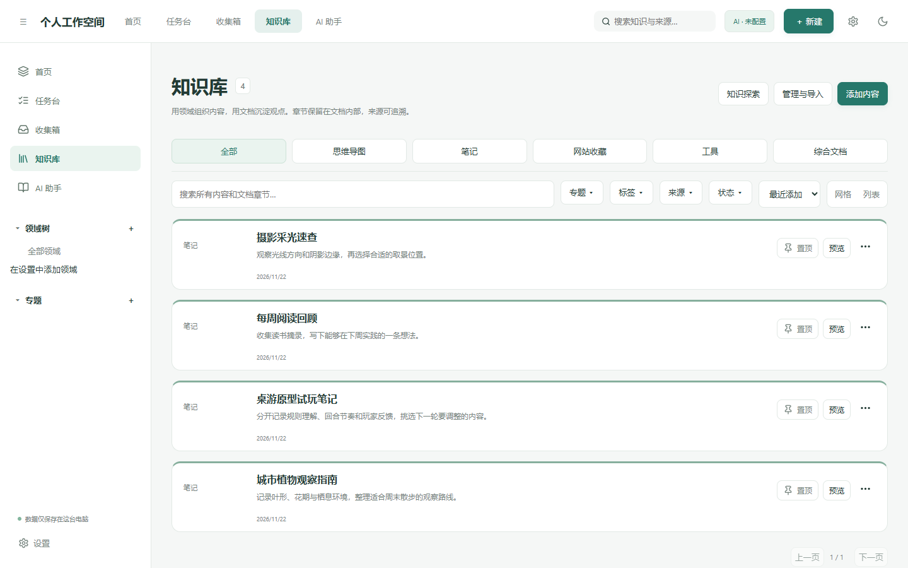
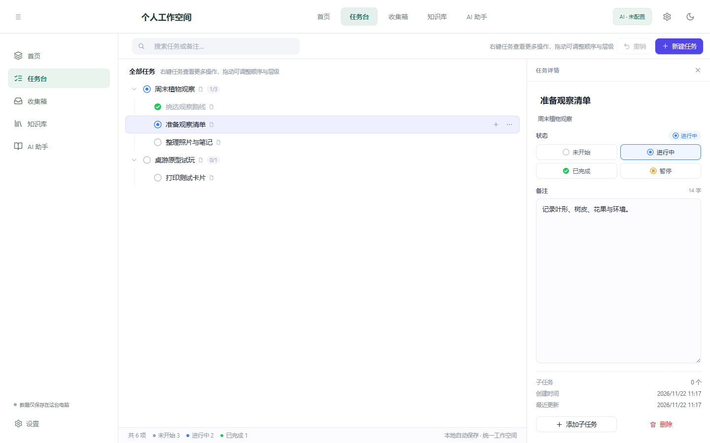

# 个人工作空间 · PersonalWorkspace

一个在 Windows 本机运行的个人工作台，用来收集资料、整理知识和管理任务。React 界面由本机 Node.js 服务提供，知识与任务各自存储在 SQLite 数据库中。

## 界面预览

| 知识库 | 任务台 |
| --- | --- |
|  |  |

截图使用虚构示例数据。点击图片可查看大图。

## 快速开始

1. 准备 **Windows 10 或 11**、**Node.js 24（含 npm）** 和 Edge 或 Chrome。
2. 克隆仓库，或从 GitHub 的 **Code → Download ZIP** 下载并解压。
3. 双击仓库根目录的 [启动个人工作空间.bat](启动个人工作空间.bat)。首次启动会联网安装依赖并构建页面。
4. 浏览器打开 [http://127.0.0.1:5180/](http://127.0.0.1:5180/) 后，可在收集箱快速记一条笔记，或到任务台新建任务。

首次使用会在本机创建数据目录，可以直接开始使用。AI 配置可选。退出时可双击 [停止个人工作空间.bat](停止个人工作空间.bat)，或在 **设置 → 本地运行** 中正常停止。

## 主要功能

- **首页与收集箱** · 快速记录、处理待办资料、回到最近阅读。
- **知识库** · 管理笔记、网页收藏、工具、综合文档和思维导图，按领域、标签与专题组织内容。
- **任务台** · 用任务树拆分工作，支持拖拽、状态、备注、搜索与撤销。
- **AI 助手** · 可在设置中配置服务，按需使用知识问答与整理辅助。配置后，发送请求前可查看并确认费用。

## 数据与备份

知识、任务、附件和设置中的草稿存储在本机 `data/`。需要迁移或保留副本时，使用 **设置 → 数据与备份 → 导出工作空间备份**，统一打包知识和任务。旧知识库 ZIP 和旧任务台 JSON 也可按各自范围恢复或导入。[备份、恢复与旧项目迁移](docs/INTEGRATION_V1_0.md)

## 版本与开发

默认分支 `main` 展示 **V1.0 整合版**。[专业知识 V0.1](https://github.com/LINQI2/PersonalWorkspace/tree/codex/professional-knowledge-v01) 位于单独的开发分支，已有独立领域树、知识卡和只读查询接口。

开发者可运行 `npm ci` 安装依赖、`npm run build` 构建和检查类型、`npm test` 运行自动测试。源码入口、导入格式、AI 配置和版本历史见[文档索引](docs/README.md)。
